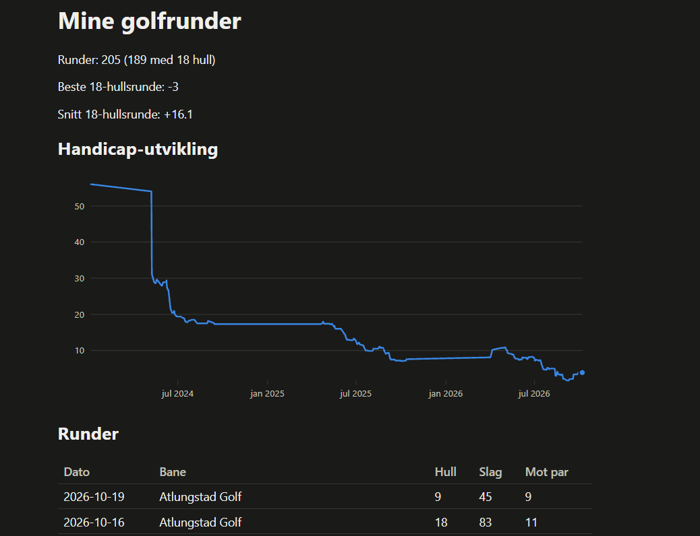
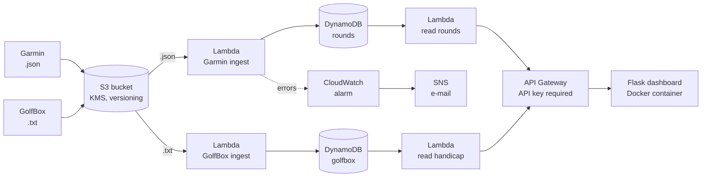

# golf-stats

En liten serverless pipeline som gjør mine egne golfdata om til et dashboard. Bygget i AWS som en praktisk måte å lære cloud-infrastruktur, Infrastructure as Code, CI/CD og DevSecOps.



## Hva den gjør

- Tar imot to typer data som jeg eksporterer manuelt: runde-sammendrag fra Garmin (JSON) og handicap-historikken fra GolfBox (tab-separert tekst som jeg kopierer fra min egen konto).
- Når en fil lastes opp til S3, trigger det en Lambda-funksjon som parser filen og lagrer rundene i DynamoDB.
- Et read-API (API Gateway + Lambda, beskyttet med API key) returnerer dataene.
- Et lite Flask-dashboard, pakket som et Docker-image, tegner handicap-kurven og en tabell over rundene.

Nesten alt i AWS er definert i Terraform (noen få bootstrap-ting er listet lenger ned) og deployes av en GitHub Actions-pipeline som logger inn med OIDC, så det finnes ingen lagrede AWS-nøkler.

## Arkitektur



## Designvalg

- **DynamoDB i stedet for RDS.** Ingen VPC, ingen passord å rotere, nesten ingen kostnad, og når en post skrives med en nøkkel som allerede finnes, erstatter den den gamle. Da kan samme fil lastes opp flere ganger uten duplikater. En Lambda i en VPC som må nå Secrets Manager ville trengt NAT gateway eller betalte endpoints, og det står ikke i forhold til noen hundre rader.
- **Én Lambda og én IAM-rolle per datakilde og retning (least privilege).** Ingest-rollene kan bare skrive til sin egen tabell, og read-rollene kan bare lese sin egen. En feil i én funksjon kan ikke røre den andre tabellen.
- **Stabile nøkler uten ID fra kilden.** Radene fra GolfBox har ingen ID, så nøkkelen er datoen pluss et løpenummer per dato, talt fra den eldste raden (for eksempel `2026-06-15#1`). Nye runder havner øverst i listen og endrer ikke eksisterende nøkler.
- **Data minimization.** Garmin profil-ID og kunde-ID lagres aldri i databasen.
- **Ingen scraping.** GolfBox-dataene kopieres manuelt fra min egen konto. Ingen innloggingsdetaljer til golftjenester lagres i AWS eller i pipelinen.
- **Kostnad.** Kostnaden når ingenting skjer er omtrent $1–2 i måneden (ca. $0,03–0,06 per dag i Cost Explorer etter at jeg ryddet bort gamle eksperimenter). Kontoen går på AWS Free Plan, som utløper på en fast dato, så infrastrukturen er laget for å kunne bygges opp igjen fra dette repoet.

## CI/CD og security checks

| Workflow | Hva den gjør |
|---|---|
| `terraform.yml` (push til `main`) | Kjører `pytest` og `terraform fmt -check` først. Bare hvis de består, kjører den `terraform plan` og `apply` med en rolle den får via OIDC. Etter deploy kaller smoke tests det ekte API-et (med og uten nøkkel). |
| `security.yml` | `gitleaks` skanner hele git-historikken etter secrets. `checkov` skanner Terraform og Dockerfilen. Aksepterte risikoer står med begrunnelse i `.checkov.yaml`, og det som gjenstår å fikse ligger som en egen backlog der. |
| `dashboard.yml` | Bygger Docker-imaget, skanner det med Trivy (feiler på HIGH/CRITICAL-funn som har en fix), starter containeren og krever at `/health` svarer. |
| Dependabot | Ukentlige PR-er med oppdateringer for pip, Docker, GitHub Actions og Terraform providers. |

Noe av det disse sjekkene allerede har fanget eller bevist:

- Deploy-gaten stopper deploy når testene er røde (bevist ved å ødelegge parseren med vilje).
- Container-sjekken feiler når en fil mangler i imaget (en glemt `COPY`-linje besto alle unit tests, men krasjet containeren).
- Trivy fant HIGH-sårbarheter i Python-pakker som ikke var en del av appens egne avhengigheter. Minst én (msgpack) viste seg å være en kopi som følger med inni `pip`. Å fjerne `pip` fra det ferdige imaget fjernet funnene.
- Oppdateringer av GitHub Actions ble merget én og én mens jeg fulgte deploy-pipelinen, fordi PR-sjekkene ikke kjører `terraform.yml`.

## Tester

- Unit tests (pytest) dekker parserne, handlerne (med en fake table i stedet for AWS), reader-koden, graf-koden og dashboardet. Skrevet test-first.
- Smoke tests i `smoke/` kjører etter hver deploy mot det ekte API-et.

```bash
python -m venv .venv
source .venv/bin/activate
pip install -r dashboard/requirements.txt pytest
pytest
```

## Kjør dashboardet lokalt

```bash
docker build -t golf-dashboard dashboard
docker run --rm -p 8080:8080 \
  -e API_URL=<rounds endpoint> \
  -e HANDICAP_URL=<handicap endpoint> \
  -e API_KEY=<api key> \
  golf-dashboard
```

Endpointene er Terraform outputs (`api_url`, `handicap_url`). API-nøkkelen hentes fra API Gateway og lagres aldri i repoet.

## Laget for hånd (bootstrap)

Noen få ting ble laget manuelt i AWS-konsollet og ligger ikke i Terraform. De er listet her slik at oppsettet kan gjenskapes:

- S3 bucket som holder Terraform state (den kan ikke opprettes av konfigurasjonen som lagrer sin egen state).
- GitHub OIDC identity provider og deploy-rollen pipelinen bruker, inkludert permission policy.
- SNS topic for alarmer og e-post-subscription.
- Den customer-managed KMS-nøkkelen som brukes til S3-kryptering.
- Budgets og oppsett av AWS Config.

## Ikke gjort ennå

- Dashboardet kjører i Docker lokalt. Å kjøre det på ECS Fargate bak en load balancer, med WAF, er planlagt men ikke bygget, fordi det koster penger mens det kjører.
- Noen `checkov`-funn ligger på en backlog (X-Ray tracing, API Gateway-logging, Lambda concurrency limits).
- DynamoDB-lesing bruker `Scan`, som går fint for noen hundre rader, men som ikke bruker pagination.
- Ingen alarm på GolfBox-ingest (bare Garmin-ingest har alarm).
- Pull requests kjører bare `security.yml` og `dashboard.yml`. `pytest` og `terraform fmt` kjører bare ved push til `main`, og det er ingen `terraform plan` på PR-er.
- Ingen branch protection på `main`.

## Om hvordan dette ble bygget

Jeg bygde dette prosjektet for å lære AWS og for å bruke det jeg har lært gjennom studiet i praksis.

Koden er i stor grad skrevet av Claude, som jeg brukte som tutor og pair programmer. Min del var å sette meg inn i hva koden gjør, kjøre den, feilsøke når noe feilet og ta valgene om hvordan ting skulle settes opp. Vi jobbet i små steg, med testene skrevet før koden.

Personlige datafiler (eksporter fra Garmin og GolfBox) ligger ikke i repoet.